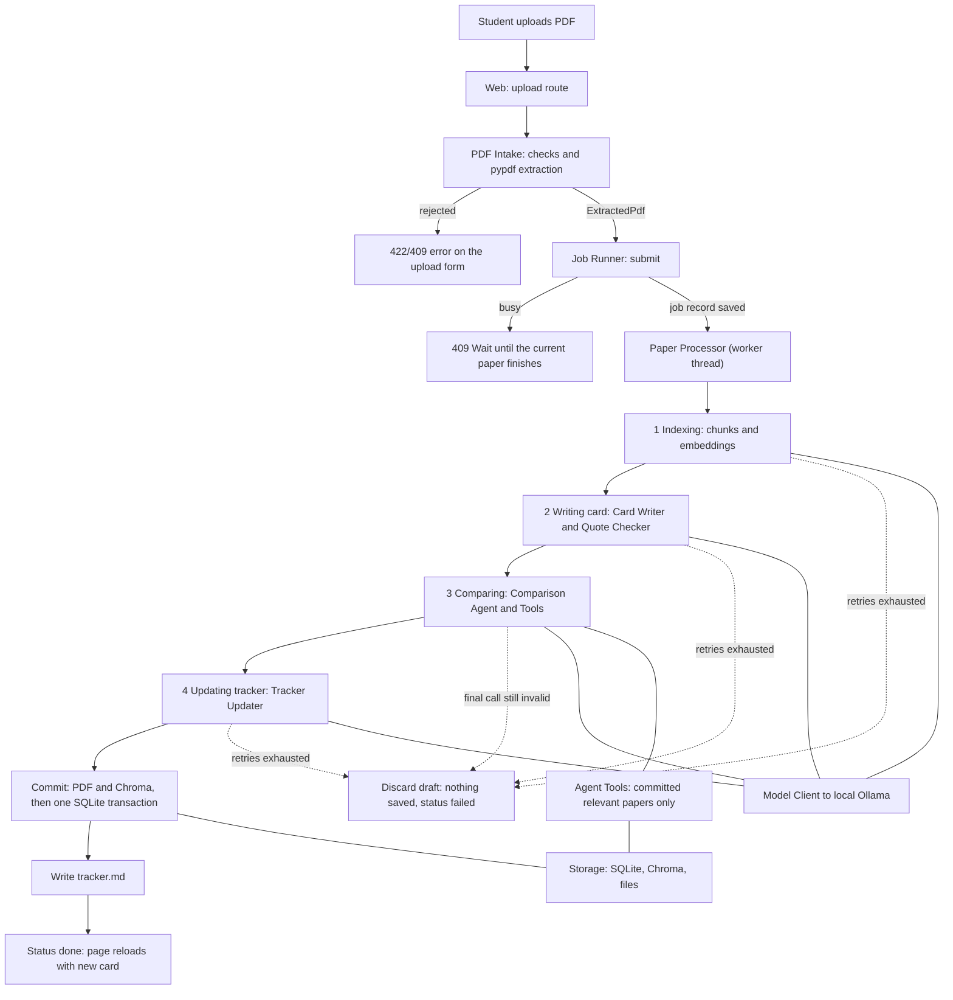

# Application Design: Research Tracker (Consolidated)

This document combines `components.md`, `component-methods.md`, `services.md` and `component-dependency.md` into one file. The four source files are the ones to edit. This file is regenerated from them.

## Key Design Decisions

| # | Decision | Choice | Source |
|---|---|---|---|
| 1 | Code organization | One module or subpackage per component; the Paper Processor is the only orchestrator | Q1 |
| 2 | Background processing | One dedicated worker thread, one paper at a time | Q2 |
| 3 | Progress | The page polls a status endpoint with a small script; status lives on the server | Q3 |
| 4 | All-or-nothing save | Work in memory; at the end, write PDF and Chroma, then one SQLite transaction as the commit point; start-up cleanup removes anything uncommitted; reads return committed data only | Q4 |
| 5 | Model client | `ModelClient` interface; real client uses `openai` against local Ollama; fake returns scripted answers per step, in order, and fails loudly when they run out | Q5 |
| 6 | Structured output | Pydantic models, JSON schema passed to Ollama where supported, always validated | Q6 |
| 7 | Tool calling | Native tool calling; the cap counts model calls; a failed turn is re-asked up to 2 times (counting toward the cap); then a tool-free final call, retried alone up to 2 more times (worst case cap + 3) | Q7, follow-up 1, FR-6.3, FR-6.4 |
| 8 | Web pages | Jinja2 + HTML `<details>`; only JavaScript is the polling script | Q8 |
| 9 | Evaluation | Calls the Paper Processor directly with `data_dir=eval-data`, without the Job Runner | Q9 |
| 10 | Settings | `pydantic-settings`; start-up fails naming any bad setting; Ollama URL must be localhost | Q10 |
| 11 | Database schema | `schema.sql` with a version number; mismatch stops start-up with a clear message | Q11 |
| 12 | Interrupted papers | The job record is saved before processing, outside the paper's commit, and becomes a notice at start-up | FR-11.6 |
| 13 | `tracker.md` | Regenerated at every start-up and after every successful commit | Application design Q4, FR-13.1 |
| 14 | Upload response | 202 with job status (changed from the technical document's 201 example, because processing is in the background) | FR-10.1 |

## Items Left for Functional Design

- Exact validation rules for classifications, cards and quotes, and the tool argument limits
- SQLite tables and columns, and the Chroma metadata fields
- Tuning defaults (A-2): chunk size, batch size, model-call cap (6–8), minimum quote words, text threshold, seed count
- How thinking mode is switched, and how it interacts with JSON schemas (A-3, Q6); how context size is applied (A-4)
- Prompt wording, including how paper text is marked as content (C-3)
- The label file format (FR-17.5), coordinated with the test set workstream
- Property-based test properties (PBT-01, advisory) for the pure functions listed in Part 4

---

## Part 1: Components: Research Tracker

**Decisions applied**: application-design-plan.md Q1–Q11 and follow-up 1. Business rules (exact validation logic, prompt wording, thresholds, table columns) are left to each unit's Functional Design.

### Package Layout

The code is organized by component (Q1: A). Each component has one module or subpackage, so owners mostly edit their own files.

```text
research_tracker/
    main.py              # app factory and start-up sequence (Web + Job Runner wiring)
    settings.py          # 1  Settings
    models.py            #    Shared data types (see below)
    pdf_intake.py        # 2  PDF Intake
    indexer.py           # 3  Indexer
    model_client/        # 4  Model Client
        base.py          #    ModelClient interface
        ollama.py        #    real client (openai library -> Ollama)
        fake.py          #    scripted fake for tests
    cards.py             # 5  Card Writer
    quotes.py            # 6  Quote Checker (pure functions + replacement request)
    agent/               # 7  Comparison Agent, 8 Agent Tools
        comparison.py
        tools.py
        validation.py
        prompts.py
    tracker_updater.py   # 9  Tracker Updater
    coverage.py          # 10 Coverage (pure functions)
    export.py            # 11 Markdown Exporter
    storage/             # 12 Storage
        db.py            #    SQLite
        schema.sql
        passages.py      #    Chroma
        files.py         #    PDFs, tracker.md, timing log
        store.py         #    TrackerStore facade: reads, commit, cleanup
    timing.py            #    step timer used by the Processor
    processor.py         # 13 Paper Processor (the only orchestrator)
    jobs.py              # 14 Job Runner
    web/                 # 15 Web
        routes.py
        templates/       #    Jinja2 (autoescape on)
        static/poll.js   #    the only JavaScript (progress polling)
    evaluate/            # 16 Evaluation
        __main__.py      #    uv run python -m research_tracker.evaluate
        report.py
        checklist.py
        stored_check.py
Modelfile                # repository root (FR-15.2)
.env.example
```

### Shared Data Types (`models.py`)

These types cross component boundaries. They are Pydantic models (Q6), so the same definitions validate model output, move data between components, and serialize to SQLite.

| Type | Purpose | Key fields (types refined in Functional Design) |
|---|---|---|
| `ExtractedPdf` | Result of a successful upload check | `sha256`, `original_filename`, `data: bytes`, `pages: list[str]` (index 0 = PDF page 1) |
| `Chunk` | A piece of text with page references | `chunk_id`, `pdf_pages: list[int]`, `text` |
| `PassageRef` | A pointer to a source passage | `paper_id` (or `NEW` for the paper being processed), `chunk_id`, `pdf_page` |
| `Passage` | A passage returned to the model or shown to the user | `PassageRef` fields + `display_name`, `text` |
| `Quote` | A card quote and its check result | `text`, `pdf_page`, `status` (`verified`, `not_found`, `too_short`), `replaced: bool` |
| `Finding` | A finding relevant to the question | `text`, `passages: list[PassageRef]` |
| `Card` | A paper card | `title`, `authors`, `year` (each value or "unavailable"), `findings`, `methods`, `limitations`, `quotes: list[Quote]` |
| `LabelKind` | Enum | `new_angle`, `adds_to`, `redundant`, `not_relevant` |
| `Relationship` | Enum (for `adds_to`) | `agrees`, `contradicts`, `extends`, `unclear` |
| `Classification` | The validated label | `kind`, `section_id` or `new_section_name`, `redundant_with_paper_id`, `relationship`, `related_section_ids`, `reason`, `citations: list[PassageRef]` |
| `Section` | A tracker section | `section_id`, `name` (fixed), `summary` |
| `TrackerUpdate` | Section and overview changes to save | `new_section` or `updated_section_id`, `section_summary`, `overview` |
| `PaperDraft` | Everything about one paper, held in memory until commit (Q4) | `extracted`, `chunks`, `chunk_embeddings`, `card_embedding`, `card`, `classification`, `tracker_update` |
| `PaperRecord` | A committed paper as read back | `paper_id`, `display_name`, `original_filename`, `card`, `classification`, `primary_section_id` |
| `TrackerView` | Everything the tracker page and export need | `tracker`, `sections`, `papers`, `not_relevant`, `coverage`, `notices` |
| `Coverage` | Counts and year range | `section_counts`, `redundant_count`, `total_count`, `earliest_year`, `latest_year`, `unknown_year_count` |
| `JobStatus` | Progress shown on the page | `state` (`idle`, `processing`, `done`, `failed`), `step`, `original_filename`, `error`, `paper_id` |
| `Notice` | Interrupted-paper notice (FR-11.6) | `notice_id`, `original_filename` |

---

### 1. Settings (`settings.py`)

- **Purpose**: one typed place for every setting.
- **Responsibilities**:
  - read `.env` with `pydantic-settings` (Q10): model name, context length, thinking mode, data folder, Ollama URL
  - hold the tuning values set in Functional Design (A-2): chunk size, batch size, model-call cap, minimum quote length, "too little text" threshold, seed count
  - fail at start-up with a message naming any missing or invalid setting (US-02)
  - reject an Ollama URL that is not on localhost (C-2)
- **Interface**: `Settings` object passed to the components that need it. Nothing reads environment variables directly.
- **Stories**: US-02, US-29

### 2. PDF Intake (`pdf_intake.py`)

- **Purpose**: decide, during the upload request, whether a file can become a paper (FR-2.2).
- **Responsibilities**:
  - check the `%PDF-` marker, size, encryption, page count, the 10-paper limit and extractable text
  - extract text page by page with `pypdf`
  - compute SHA-256 and check for duplicates against committed papers
  - raise a `PdfRejected` error with a plain-language message
- **Interface**: `check_upload(...) -> ExtractedPdf` or `PdfRejected`.
- **Stories**: US-04, US-05, US-06

### 3. Indexer (`indexer.py`)

- **Purpose**: turn pages into chunks with page references, and embed them.
- **Responsibilities**:
  - chunk pages within the size set in Settings
  - embed chunks and the card text through the Model Client
  - search the new paper's own chunks in memory, for the `search_passages` tool with `scope="new"`
- **Interface**: `chunk_pages`, `embed_chunks`, `embed_text`, `InMemoryPassages`.
- **Stories**: US-04

### 4. Model Client (`model_client/`)

- **Purpose**: the only route to Ollama (C-2), and the seam where the fake model replaces it (Q5).
- **Responsibilities**:
  - **chat**: messages, optional tools, optional output schema, and thinking on or off
  - **embeddings**
  - turn transport failures into one `ModelError` type
  - the real client uses the `openai` library pointed at local Ollama
  - **the fake client** returns scripted answers per step name, taken from a list in order (Q5 addition). It raises an error when a step's list runs out, and returns fixed embeddings
- **Interface**: `ModelClient` protocol with `chat(...)` and `embed(...)`. Every component receives a `ModelClient`; none imports `openai`.
- **Stories**: all model-dependent stories; NFR-4.2

### 5. Card Writer (`cards.py`)

- **Purpose**: produce a validated `Card` with a fixed sequence of model calls (FR-4.1).
- **Responsibilities**:
  - read the chunks in batches that fit the context, and collect relevant findings with passage references
  - assemble the card and validate it against its Pydantic schema
  - run every quote through the Quote Checker, including the one replacement request
- **Interface**: `write_card(...) -> Card`.
- **Stories**: US-09, US-10

### 6. Quote Checker (`quotes.py`)

- **Purpose**: decide, in code, whether a quote is on its cited page (FR-5, C-7).
- **Responsibilities**:
  - normalize text (line-break hyphens, whitespace)
  - check the minimum length
  - verify the quote against the page text
  - ask the model once for a replacement and check it the same way
  - shared by the Card Writer and the Evaluation stored-data check, so both use one definition
- **Interface**: pure `normalize`, `check_quote`; plus `check_with_replacement(...)` (calls the model).
- **Stories**: US-10, US-26, US-27; NFR-4.4, NFR-4.6

### 7. Comparison Agent (`agent/comparison.py`, `validation.py`, `prompts.py`)

- **Purpose**: give each new paper exactly one valid `Classification`.
- **Responsibilities**:
  - **No sections yet**: make the single tool-free call (FR-6.0)
  - **Otherwise**, run the loop:
    - seed it with similar cards of committed papers that have a section
    - use native tool calling (Q7)
    - count model calls toward the cap, re-asking a failed turn up to 2 times (FR-6.3)
    - make the final tool-free call, retrying only that call (FR-6.4)
  - validate the result: the label kind, that the section or paper it names exists and has a section, that every citation was retrieved, and the both-papers rule for cross-paper labels
  - keep paper text out of the instructions (C-3): paper text goes only in clearly marked content, never in the system message
- **Interface**: `classify(...) -> Classification` or `ComparisonFailed`.
- **Stories**: US-11, US-12, US-13, US-14, US-15

### 8. Agent Tools (`agent/tools.py`)

- **Purpose**: the read-only lookups the model may call (FR-6.2).
- **Responsibilities**:
  - provide `search_passages`, `read_card` and `list_sections`
  - return only committed papers that have a primary section (Q4, FR-6.2)
  - `search_passages` can also search the new paper's own chunks in memory
  - record every passage returned, so the Agent can check citations (FR-6.5)
- **Interface**: `ToolBox` with the three tools, their JSON schemas for the model, and a `seen_passages` set.
- **Stories**: US-12, US-14

### 9. Tracker Updater (`tracker_updater.py`)

- **Purpose**: work out the section and overview changes for one classified paper (FR-8).
- **Responsibilities**:
  - choose the new or existing section
  - rewrite the section summary in small batches
  - rewrite the overview
  - never rename a section
  - return the changes, without saving them
- **Interface**: `plan_update(...) -> TrackerUpdate`.
- **Stories**: US-19

### 10. Coverage (`coverage.py`)

- **Purpose**: counts and year range, computed by code from saved data (FR-9, C-7).
- **Responsibilities**: section counts (primary section only), redundant count, total count, year range, unknown-year count.
- **Interface**: pure `compute_coverage(papers) -> Coverage`.
- **Stories**: US-20, US-21, US-25; NFR-4.4

### 11. Markdown Exporter (`export.py`)

- **Purpose**: render `tracker.md` from saved data (FR-13), with no model call (C-7).
- **Responsibilities**:
  - render the question, overview, sections, cards, labels, the not-relevant group, coverage and the year range
  - number the footnotes and mark unverified quotes
- **Interface**: pure `render_markdown(view) -> str`. The file is written through Storage.
- **Stories**: US-22, US-27

### 12. Storage (`storage/`)

- **Purpose**: everything kept on disk, plus the all-or-nothing save (Q4: A).
- **Responsibilities**:
  - **`db.py`**:
    - SQLite with one connection per thread (Q2)
    - `?` placeholders only (C-5)
    - schema from `schema.sql` with a schema version number; refuses to start on a version mismatch, with a clear message (Q11 addition)
  - **`passages.py`**:
    - Chroma, with telemetry off (C-1)
    - one collection for passages and one for card embeddings, each entry tagged with `paper_id`
    - every query is filtered to a set of allowed paper IDs
    - Chroma never embeds anything itself, so it never downloads its default model (C-2):
      - both collections are created with an explicit embedding function that raises an error if called
      - entries are always added with precomputed `embeddings=` and searched with `query_embeddings=`
      - raw text is stored only as data, never passed for Chroma to embed (`query_texts=` is never used)
      - a test checks that both collections use the refusing function and that adding or querying without vectors raises the error
      - the exact behavior is confirmed against the installed Chroma version in Functional Design
  - **`files.py`**: PDFs named by SHA-256, `tracker.md`, and the timing log, all under the data folder
  - **`store.py`** (`TrackerStore`):
    - read methods that return committed data only
    - `commit(draft)`: PDF file and Chroma entries first, then one SQLite transaction that saves every row and marks the paper committed
    - start-up cleanup of anything not committed
    - the processing-job record and notices (FR-11.6), which are saved outside the paper's commit
- **Interface**: `TrackerStore` (see component-methods.md).
- **Stories**: US-08, US-23; NFR-3.1

### 13. Paper Processor (`processor.py`), a service

- **Purpose**: run one paper from `ExtractedPdf` to a committed paper. It is the only component that calls the others in sequence (Q1).
- **Responsibilities**:
  - run the steps in order: indexing, writing the card, comparing, updating the tracker, then committing and writing `tracker.md`
  - apply step retries (FR-11.1)
  - report progress through a callback
  - time each step (FR-16)
  - before commit, discard the draft on failure and remove partial paper data. After commit, an export failure leaves the paper saved
- **Interface**: `process(...) -> PaperRecord` or `ProcessingFailed`. Details in services.md.
- **Stories**: US-04, US-08; used by US-24

### 14. Job Runner (`jobs.py`)

- **Purpose**: run one paper at a time in the background (Q2: B) and own "is a paper processing?" (FR-2.5).
- **Responsibilities**:
  - start one worker thread with the app
  - `submit` saves the processing-job record and starts the work, or raises `Busy`
  - expose the current `JobStatus` for polling (Q3)
  - at start-up, run the cleanup and turn interrupted jobs into notices
- **Interface**: `JobRunner` (see component-methods.md).
- **Stories**: US-04, US-07, US-08

### 15. Web (`web/`, `main.py`)

- **Purpose**: the local pages and endpoints.
- **Responsibilities**:
  - FastAPI routes: create the tracker, the tracker page, upload, status, PDF by paper ID, export, dismiss notice
  - Jinja2 templates with autoescape on (C-4), and `<details>` for citations (Q8)
  - `poll.js` for progress (Q3)
  - map errors to plain messages (C-6)
  - **start-up** in `main.py`, in this order:
    1. load Settings
    2. check the schema
    3. run cleanup
    4. regenerate `tracker.md`
    5. start the Job Runner
  - Uvicorn binds to `127.0.0.1` (C-1)
- **Interface**: HTTP routes (see component-methods.md).
- **Stories**: US-01, US-03, US-05 to US-08, US-16 to US-23

### 16. Evaluation (`evaluate/`)

- **Purpose**: measure the app against SC-2, SC-3 and SC-5, and report timing (FR-17).
- **Responsibilities**:
  - clear `eval-data/` and build the same Processor with settings pointing there (Q9: A)
  - read the label file and process the papers in upload order, skipping the Job Runner
  - write the report and the quote checklist
  - score a completed checklist
  - run the stored-data quote check
  - summarize timing and record the settings used
- **Interface**: command line `uv run python -m research_tracker.evaluate run|score-checklist`.
- **Stories**: US-24 to US-29

---

### Story-to-Component Check

Every story has at least one owning component.

| Story | Components |
|---|---|
| US-01 | Web (`main.py`), Settings, README/Modelfile |
| US-02 | Settings |
| US-03 | Web, Storage |
| US-04 | Web, PDF Intake, Job Runner, Processor, Indexer |
| US-05 | PDF Intake, Web |
| US-06 | PDF Intake, Storage |
| US-07 | Job Runner, Web |
| US-08 | Processor, Job Runner, Storage, Web |
| US-09 | Card Writer |
| US-10 | Quote Checker, Card Writer, Web |
| US-11 | Comparison Agent |
| US-12 | Comparison Agent, Agent Tools |
| US-13 | Comparison Agent, Tracker Updater |
| US-14 | Comparison Agent, Agent Tools, Web |
| US-15 | Comparison Agent, Web |
| US-16 | Web |
| US-17 | Web, Storage |
| US-18 | Web |
| US-19 | Tracker Updater, Web |
| US-20 | Coverage, Web |
| US-21 | Coverage, Web |
| US-22 | Markdown Exporter, Storage, Web |
| US-23 | Storage, Web |
| US-24 | Evaluation, Processor |
| US-25 | Evaluation, Coverage |
| US-26 | Evaluation |
| US-27 | Evaluation, Quote Checker, Markdown Exporter |
| US-28 | Processor (timing), Evaluation |
| US-29 | Settings, Evaluation |

---

## Part 2: Component Methods: Research Tracker

Signatures are written in Python 3.12 style. Types refer to `models.py` (see components.md). These signatures are the contracts between units. Business rules, such as what makes a classification valid or exactly how text is normalized, are defined in each unit's Functional Design. Names may be refined there, but changing a signature that crosses units needs the other unit's owner to agree.

### 1. Settings

```python
class Settings(BaseSettings):          # pydantic-settings, reads .env
    model_name: str                    # e.g. "research-tracker-qwen3" (built from the Modelfile)
    embedding_model: str               # "nomic-embed-text"
    context_length: int                # must match the Modelfile (A-4)
    thinking: bool
    data_dir: Path                     # default "data"
    ollama_base_url: str               # default "http://localhost:11434/v1"; must be localhost
    tuning: Tuning                     # chunk size, batch size, model-call cap, min quote words, min text chars, seed count

def load_settings(overrides: dict | None = None) -> Settings
    """Load and validate settings; raise SettingsError naming the bad setting. Evaluation passes data_dir override."""
```

### 2. PDF Intake

```python
class PdfRejected(Exception):
    message: str                       # plain-language, shown on the upload form

def check_upload(data: bytes, original_filename: str, store: TrackerStore,
                 tracker_id: int, settings: Settings) -> ExtractedPdf
    """Run every FR-2.2 check and the duplicate check during the request; raise PdfRejected."""

def extract_pages(data: bytes, settings: Settings) -> list[str]
    """Open with pypdf, reject encrypted or too-long PDFs, return page texts (index 0 = PDF page 1)."""

def sha256_of(data: bytes) -> str
```

### 3. Indexer

```python
def chunk_pages(pages: list[str], settings: Settings) -> list[Chunk]
    """Split pages into chunks that keep their 1-based PDF page numbers. Pure."""

def embed_chunks(chunks: list[Chunk], client: ModelClient) -> list[list[float]]
def embed_text(text: str, client: ModelClient) -> list[float]

class InMemoryPassages:
    def __init__(self, chunks: list[Chunk], embeddings: list[list[float]]) -> None
    def search(self, query_embedding: list[float], k: int) -> list[Passage]
        """Search the new paper's own chunks (used by search_passages with scope="new")."""
```

### 4. Model Client

```python
class ModelError(Exception): ...       # connection failure, timeout, HTTP error

class ModelReply(BaseModel):
    content: str | None
    tool_calls: list[ToolCall]         # name + JSON arguments; empty if none

class ModelClient(Protocol):
    def chat(self, step: str, messages: list[Message], *,
             tools: list[ToolSpec] | None = None,
             schema: type[BaseModel] | None = None) -> ModelReply
        """One model call. `step` names the pipeline step (used by the fake and by timing logs)."""
    def embed(self, texts: list[str]) -> list[list[float]]

class OllamaClient(ModelClient):
    def __init__(self, settings: Settings) -> None
        """openai.OpenAI(base_url=settings.ollama_base_url); applies thinking mode and schema as confirmed in Functional Design."""

class FakeModelClient(ModelClient):
    def __init__(self, script: dict[str, list[ModelReply | Exception]],
                 embedding: Callable[[str], list[float]] | None = None) -> None
        """Returns the next scripted reply for each step, in order; raises ScriptExhausted when a step's list runs out."""
    calls: list[tuple[str, list[Message]]]   # recorded for assertions
```

### 5. Card Writer

```python
def write_card(pages: list[str], chunks: list[Chunk], question: str,
               client: ModelClient, settings: Settings) -> Card
    """Fixed sequence of model calls -> validated Card; every quote passes through check_with_replacement.
    Raises StepFailed on invalid output (retried by the Processor)."""
```

### 6. Quote Checker

```python
def normalize(text: str) -> str
    """Join line-break hyphenation, collapse whitespace. Pure."""

def check_quote(quote: str, pages: list[str], pdf_page: int, min_words: int) -> QuoteStatus
    """verified | not_found | too_short. Pure."""

def check_with_replacement(quote: Quote, pages: list[str], context: str,
                           client: ModelClient, settings: Settings) -> Quote
    """If the quote fails, ask the model once for a replacement and check it the same way (FR-5.2)."""
```

### 7. Comparison Agent

```python
class ComparisonFailed(Exception): ...

def classify(card: Card, new_passages: InMemoryPassages, card_embedding: list[float],
             question: str, store: TrackerStore, client: ModelClient,
             settings: Settings) -> Classification
    """FR-6.0 single call if there are no sections; otherwise the capped loop, then the final tool-free call."""

def classify_first(card: Card, new_passages: InMemoryPassages, question: str,
                   client: ModelClient) -> Classification
    """New angle or Not relevant, citing the new paper only (FR-6.0)."""

def run_loop(card: Card, seeds: list[PaperRecord], tools: ToolBox, question: str,
             client: ModelClient, settings: Settings) -> Classification | None
    """Model calls up to the cap; a failed turn is re-asked up to 2 times, each counting toward the cap.
    Returns None if the loop ends without a valid label."""

def final_call(card: Card, evidence: list[Passage], question: str,
               client: ModelClient) -> Classification
    """Tool-free call; retried up to 2 more times with the same evidence (FR-6.4)."""

def validate_classification(raw: ClassificationOutput, seen: set[PassageRef],
                            store: TrackerStore) -> Classification
    """Label kind, existing relevant targets, retrieved-only citations, both-paper rule. Raises InvalidOutput."""
```

### 8. Agent Tools

The model sees these three tools (names, arguments and results are part of the contract between the agent and storage units):

| Tool | Arguments | Returns |
|---|---|---|
| `search_passages` | `query: str`, `scope: "saved" \| "new"` (default `"saved"`), `k: int` (capped in code) | list of `{paper_id, display_name, chunk_id, pdf_page, text}` |
| `read_card` | `paper_id: int` | `{paper_id, display_name, section, title, authors, year, findings, methods, limitations}` |
| `list_sections` | none | list of `{section_id, name, summary, paper_count}` |

```python
class ToolBox:
    def __init__(self, store: TrackerStore, new_passages: InMemoryPassages,
                 client: ModelClient, settings: Settings) -> None
    specs: list[ToolSpec]                         # JSON schemas passed to the model (Q7)
    seen_passages: set[PassageRef]                # every passage returned, for citation checks (FR-6.5)
    def call(self, name: str, arguments: dict) -> dict
        """Run one tool; unknown tool or bad arguments raise InvalidToolCall. Read-only.
        Saved-scope results come only from committed papers that have a primary section."""
```

### 9. Tracker Updater

```python
def plan_update(classification: Classification, card: Card, question: str,
                store: TrackerStore, client: ModelClient, settings: Settings) -> TrackerUpdate
    """Pick the new or existing section, rewrite its summary (in batches) and the overview; never rename a section."""
```

### 10. Coverage

```python
def compute_coverage(papers: list[PaperRecord], sections: list[Section]) -> Coverage
    """Primary-section counts, redundant count, total, year range, unknown-year count. Pure."""
```

### 11. Markdown Exporter

```python
def render_markdown(view: TrackerView) -> str
    """tracker.md text with numbered footnotes; unverified quotes marked. Pure, no model call."""
```

### 12. Storage

```python
class SchemaMismatch(Exception): ...           # "Data folder uses an older format; delete data/ to start over."

class TrackerStore:
    def __init__(self, settings: Settings) -> None
        """Opens SQLite (per-thread connections), Chroma (telemetry off) and the file folder under settings.data_dir."""

    # Tracker
    def create_tracker(self, question: str) -> int
    def get_tracker(self) -> Tracker | None                     # one tracker in the MVP
    def get_tracker_by_id(self, tracker_id: int) -> Tracker | None

    # Committed reads (only committed papers are ever returned)
    def paper_count(self, tracker_id: int) -> int
    def paper_exists(self, tracker_id: int, sha256: str) -> bool
    def list_sections(self, tracker_id: int) -> list[Section]
    def list_papers(self, tracker_id: int) -> list[PaperRecord]
    def get_paper(self, paper_id: int) -> PaperRecord | None
    def get_pages(self, paper_id: int) -> list[str]             # stored page text, for checks (FR-17.7)
    def relevant_paper_ids(self, tracker_id: int) -> set[int]   # committed and has a primary section
    def similar_cards(self, embedding: list[float], allowed: set[int], k: int) -> list[PaperRecord]
    def search_passages(self, embedding: list[float], allowed: set[int], k: int) -> list[Passage]
    def tracker_view(self, tracker_id: int) -> TrackerView
    def pdf_path(self, paper_id: int) -> Path | None            # by ID only (FR-12.4)

    # All-or-nothing save (Q4)
    def commit(self, tracker_id: int, draft: PaperDraft) -> PaperRecord
        """Write PDF file and Chroma entries, then one SQLite transaction that saves all rows and marks the paper committed."""
    def write_tracker_md(self, tracker_id: int) -> Path          # render_markdown(tracker_view) -> file
    def cleanup_uncommitted(self) -> list[Notice]
        """Start-up: delete files and Chroma entries with no committed paper; turn leftover job records into notices."""

    # Processing-job record and notices (saved outside the paper's commit, FR-11.6)
    def start_job(self, tracker_id: int, sha256: str, original_filename: str) -> int
    def finish_job(self, job_id: int) -> None                    # on success or failure
    def list_notices(self, tracker_id: int) -> list[Notice]
    def dismiss_notice(self, notice_id: int) -> None             # deletes the record entirely

    # Timing log
    def append_timing(self, record: TimingRecord) -> None
```

### 13. Paper Processor (service)

```python
class ProcessingFailed(Exception):
    step: str
    message: str                       # plain-language, shown on the page

ProgressCallback = Callable[[str], None]   # receives "indexing" | "writing_card" | "comparing" | "updating_tracker"

class PaperProcessor:
    def __init__(self, store: TrackerStore, client: ModelClient, settings: Settings) -> None
    def process(self, tracker_id: int, extracted: ExtractedPdf,
                on_progress: ProgressCallback = lambda step: None) -> PaperRecord
        """Run all steps with retries, commit, write tracker.md; raise ProcessingFailed with nothing saved."""
```

### 14. Job Runner

```python
class Busy(Exception): ...             # "Wait until the current paper finishes."

class JobRunner:
    def __init__(self, processor: PaperProcessor, store: TrackerStore) -> None
    def start(self) -> None                         # starts the worker thread
    def stop(self, timeout: float) -> None          # on app shutdown
    def submit(self, tracker_id: int, extracted: ExtractedPdf) -> None
        """Raise Busy if a paper is processing; otherwise save the job record and hand it to the worker."""
    def status(self) -> JobStatus                   # read by the polling endpoint
    def is_busy(self) -> bool
```

### 15. Web (HTTP routes)

| Method and path | Purpose | Success | Errors |
|---|---|---|---|
| `GET /` | Create-tracker page if none exists, otherwise the tracker page | 200 HTML | — |
| `POST /trackers` | Create the tracker from the form's question | 303 to `/` | 400 empty question; 409 tracker exists |
| `POST /api/trackers/{tracker_id}/papers` | Upload one PDF; checks run in the request | 202 with `JobStatus` | 400, 413, 422 `PdfRejected`; 409 duplicate; 409 busy; 404 tracker |
| `GET /api/trackers/{tracker_id}/status` | Current `JobStatus` for polling | 200 JSON | 404 tracker |
| `GET /papers/{paper_id}/pdf` | Serve the stored PDF by ID (link adds `#page=N`) | 200 PDF | 404 unknown ID |
| `GET /trackers/{tracker_id}/export` | Download `tracker.md` | 200 Markdown attachment | 404 tracker |
| `POST /notices/{notice_id}/dismiss` | Dismiss an interrupted-paper notice | 303 to `/` | 404 unknown ID |

The technical document illustrates the same HTTP 202 response. Clients poll the status endpoint and read the finished card on the tracker page.

```python
def create_app(settings: Settings | None = None, client: ModelClient | None = None) -> FastAPI
    """Start-up order: settings -> schema check -> cleanup_uncommitted -> write_tracker_md -> JobRunner.start.
    Tests pass a FakeModelClient and a temporary data_dir."""
```

### 16. Evaluation

```python
def main(argv: list[str]) -> int
    """`run [--labels PATH] [--papers DIR]` or `score-checklist [PATH]`."""

def run(labels_path: Path, papers_dir: Path, settings: Settings, client: ModelClient) -> EvalReport
    """Clear eval-data/, create the tracker, process papers in label-file order via PaperProcessor, then build the report."""

def label_agreement(labels: list[ExpectedLabel], papers: list[PaperRecord]) -> LabelResult      # SC-3
def count_check(store: TrackerStore, tracker_id: int) -> CountResult                            # SC-5
def write_checklist(store: TrackerStore, tracker_id: int, path: Path) -> None                   # FR-17.6
def score_checklist(path: Path) -> ChecklistResult                                               # SC-2
def stored_quote_check(store: TrackerStore, tracker_id: int, tracker_md: Path) -> list[QuoteMismatch]  # FR-17.7
def timing_summary(timing_log: Path) -> TimingSummary                                            # FR-16, US-28
def render_report(report: EvalReport) -> str                                                     # includes settings used (US-29)
```

---

## Part 3: Services: Research Tracker

There are three services, meaning components that call other components in sequence. The Paper Processor is the only one that chains processing steps (Q1). The Job Runner decides *when* the Processor runs in the app, and the Evaluation decides when it runs in tests.

### 1. Paper Processor

**Owns**: one paper's journey from `ExtractedPdf` to a committed `PaperRecord`, or to nothing.

#### Flow

```text
(upload request, in Web)
  check_upload -> ExtractedPdf                    # FR-2.2, rejections are immediate
  JobRunner.submit                                # saves the job record, or raises Busy

(background, in the Processor)
  1. indexing          chunk_pages, embed_chunks
  2. writing_card      write_card (includes quote checks and one replacement per failed quote)
                       embed_text(card) -> card_embedding
  3. comparing         classify (first-paper call, or loop + final call)
  4. updating_tracker  plan_update (section summary + overview)
  -- everything so far lives in a PaperDraft in memory; nothing is on disk --
  5. commit            TrackerStore.commit(draft)      # PDF file + Chroma, then one SQLite transaction
  6. export            TrackerStore.write_tracker_md   # regenerated from saved data
  finish_job, report done
```

#### Rules the Processor applies

| Concern | Behavior | Source |
|---|---|---|
| Progress | Calls `on_progress(step)` at the start of steps 1–4 | FR-10.2 |
| Timing | Times extraction (passed in from the request) and steps 1–4, and appends one record per step to the timing log, with the step name, duration, model name and settings | FR-16.1, CQ7 |
| Step retries | Steps 1, 2 and 4: a `StepFailed` or `ModelError` reruns that step, up to 2 more times | FR-11.1 |
| Comparison | Step 3 is never rerun as a whole. Retries happen inside the agent (turn re-asks, then retries of the final call only) | FR-6.3, FR-6.4, FR-11.1 |
| Failure | After the retries run out, the draft is discarded. Because nothing was written yet, nothing is left. `finish_job` runs, and `ProcessingFailed(step, message)` is raised | FR-11.2, FR-11.3 |
| Commit failure | If the commit itself fails partway (for example a disk error after the PDF is written), anything written is removed, by the same rule start-up cleanup uses: anything without a committed SQLite row is deleted | FR-11.2, Q4 |
| Export after commit | If writing `tracker.md` fails after a successful commit, the paper stays saved. `tracker.md` is regenerated at the next start-up or after the next upload | Application design Q4, FR-13.1 |
| Quote failures | Never fail a step. They become quote statuses and the card-level note | FR-5.4, FR-11.5 |

#### Worst-case model calls per paper

Per attempt: card writing calls, plus at most one replacement call per quote. Then the comparison step, at most cap + 3 model calls. Then the summary and overview calls. Steps 1, 2 and 4 can each run up to 3 times. The exact numbers depend on the tuning values set in Functional Design.

### 2. Job Runner

**Owns**: running one paper at a time in the background, plus the start-up recovery.

#### Submit and run

```text
submit(tracker_id, extracted)
  if busy -> raise Busy                      # FR-2.5, checked under a lock
  job_id = store.start_job(...)              # saved BEFORE processing, outside the paper commit (FR-11.6)
  status = processing(step=None, filename)
  hand (job_id, tracker_id, extracted) to the worker thread

worker thread
  processor.process(..., on_progress=update status.step)
  success -> status = done(paper_id)
  ProcessingFailed -> status = failed(message)
  finally -> store.finish_job(job_id); busy = False
```

- **One worker thread**, started with the app (Q2: B). It uses its own SQLite connection.
- **Status** is kept in memory and read by `GET /status`. A refreshed page or a new tab sees the current step right away (Q3).
- **After `done` or `failed`**, the status stays visible until the next upload, so the page can show the result or the error.

#### Start-up recovery (before the worker starts)

```text
notices = store.cleanup_uncommitted()
  - delete PDF files and Chroma entries whose paper is not committed
  - leftover job records for uncommitted papers become interruption notices
store.write_tracker_md(tracker)               # always regenerated; cheap, no model
JobRunner.start()
```

- **Notices** are shown on the tracker page until they are dismissed. Dismissing one deletes the record, so nothing about that paper remains (FR-11.6).

#### Shutdown

`stop(timeout)` asks the worker to stop. Nothing partial can be committed, because commit is the last step. Anything already written is cleaned up at the next start.

### 3. Evaluation

**Owns**: measuring the pipeline on the labeled test set (Q9: A).

```text
run(labels, papers_dir)
  settings = load_settings(overrides={"data_dir": "eval-data"})
  delete and recreate eval-data/                          # FR-17.2
  store = TrackerStore(settings); tracker = create_tracker(question from label file)
  processor = PaperProcessor(store, client, settings)     # same Processor, no Job Runner
  for paper in labels (in upload order):
      extracted = check_upload(...)                      # same intake checks
      try processor.process(...) except ProcessingFailed -> record failure, continue
  report = label_agreement + count_check + stored_quote_check + timing_summary + settings used
  write_checklist(eval-data/quote-checklist.md)
  print and save the report

score-checklist(path)
  read found / not found / unmarked marks -> SC-2 result
```

- **Real model by default**, so the results measure Qwen3. Its own tests use the fake model.
- **Viewing results**: setting `DATA_DIR=eval-data` in `.env` and starting the web app opens the run's results (FR-17.4).

### Interaction Summary

| Caller | Calls | When |
|---|---|---|
| Web (upload route) | PDF Intake, then Job Runner `submit` | During the upload request |
| Web (status route) | Job Runner `status` | Every few seconds while the page polls |
| Web (pages, export, PDF) | TrackerStore reads, Coverage, Exporter | On page load or download |
| Job Runner | Paper Processor | In the worker thread |
| Paper Processor | Indexer, Card Writer, Comparison Agent, Tracker Updater, TrackerStore | In order, per paper |
| Comparison Agent | Agent Tools, Model Client | Inside the comparing step |
| Evaluation | PDF Intake, Paper Processor, TrackerStore, Coverage, Quote Checker, Exporter | Command line |

---

## Part 4: Component Dependencies: Research Tracker

All communication is in-process Python function calls. The only network traffic is to local Ollama, through the Model Client (C-2). There are no message queues or other services.

### Dependency Matrix

Read across: the row component **uses** the column component. `models.py` and Settings are used by almost everything and are left out to keep the table readable.

| Uses → | Intake | Indexer | Model Client | Card Writer | Quote Checker | Agent | Tools | Tracker Updater | Coverage | Exporter | Storage | Processor | Job Runner |
|---|---|---|---|---|---|---|---|---|---|---|---|---|---|
| **Web** | ✓ | | | | | | | | ✓ | | ✓ | | ✓ |
| **Job Runner** | | | | | | | | | | | ✓ | ✓ | |
| **Processor** | | ✓ | ✓ | ✓ | | ✓ | | ✓ | | | ✓ | | |
| **Evaluation** | ✓ | | ✓ | | ✓ | | | | ✓ | ✓ | ✓ | ✓ | |
| **Agent** | | | ✓ | | | | ✓ | | | | ✓ | | |
| **Tools** | | ✓ | ✓ | | | | | | | | ✓ | | |
| **Tracker Updater** | | | ✓ | | | | | | | | ✓ | | |
| **Card Writer** | | | ✓ | | ✓ | | | | | | | | |
| **Quote Checker** | | | ✓ | | | | | | | | | | |
| **Indexer** | | | ✓ | | | | | | | | | | |
| **Intake** | | | | | | | | | | | ✓ | | |
| **Storage** | | | | | | | | | ✓ | ✓ | | | |
| **Coverage** | | | | | | | | | | | | | |
| **Exporter** | | | | | | | | | | | | | |
| **Model Client** | | | | | | | | | | | | | |

**No loops**. The components form layers, and each one uses only layers below it:

| Layer | Components |
|---|---|
| 5 | Web, Evaluation |
| 4 | Job Runner |
| 3 | Paper Processor |
| 2 | Comparison Agent |
| 1 | Agent Tools, Card Writer, Tracker Updater, PDF Intake |
| 0 | Indexer, Quote Checker, Storage |
| Base | Model Client, Coverage, Exporter, `models.py`, Settings |

Storage uses Coverage and the Exporter (both pure functions) to build the tracker view and `tracker.md`. They depend on nothing, so no loop forms.

**Coupling rules**:
- Only the Processor calls processing steps in sequence (Q1).
- Only the Model Client imports `openai`.
- Only Storage imports `sqlite3` and `chromadb`.
- The Agent and the Tools see Storage only through committed, relevant-only read methods.

### Data Flow: Uploading One Paper

#### Mermaid Diagram



#### Text Alternative

```text
Upload request (Web)
  -> PDF Intake: %PDF-, size, encryption, pages, text, 10-paper limit, duplicate
       rejected -> error shown immediately, nothing saved
  -> Job Runner.submit
       busy -> "Wait until the current paper finishes"
       else -> save job record, hand to worker thread, return 202

Worker thread (Paper Processor), all results kept in memory:
  1 Indexing          -> Indexer + Model Client (embeddings)
  2 Writing card      -> Card Writer + Quote Checker + Model Client
  3 Comparing         -> Comparison Agent + Agent Tools (committed, relevant papers only) + Model Client
  4 Updating tracker  -> Tracker Updater + Model Client
  any step fails after its retries -> discard draft, nothing saved, status "failed"

Commit (Storage): PDF file + Chroma entries, then ONE SQLite transaction (the commit point)
Write tracker.md from saved data
Status "done" -> page (polling) reloads and shows the new card and label
```

### Data Flow: Viewing and Inspecting

```text
GET /            -> TrackerStore.tracker_view -> Coverage.compute_coverage -> Jinja2 template (autoescape)
<details> click  -> no request; the passage is already in the page
PDF link         -> GET /papers/{id}/pdf#page=N -> TrackerStore.pdf_path(id) -> file (by ID only)
Export           -> GET /trackers/{id}/export -> current tracker.md
Polling          -> GET /api/trackers/{id}/status -> JobRunner.status
```

### Where Each Shared Constraint Is Enforced

| Constraint | Enforced in | How |
|---|---|---|
| C-1 Localhost only, telemetry off | `main.py`, README, Storage (`passages.py`) | Uvicorn host `127.0.0.1`; Chroma `anonymized_telemetry=False` |
| C-2 No outside requests | Settings, Model Client, Storage (`passages.py`) | Ollama URL must be localhost; only the Model Client makes network calls; Chroma collections use an embedding function that refuses to run and receive only precomputed vectors, so Chroma never downloads its default model. Optional: a test that blocks network access while the fake-model pipeline runs |
| C-3 Paper text never instructions | Comparison Agent (`prompts.py`), Card Writer, Tracker Updater, Agent Tools | Fixed system messages; paper text only in clearly marked content; tools are read-only |
| C-4 Autoescaping | Web templates | Jinja2 autoescape on; no `\|safe` on paper text or model output |
| C-5 SQL placeholders | Storage (`db.py`) | Only module that runs SQL; `?` placeholders only |
| C-6 Plain error messages | PDF Intake, Processor, Job Runner, Web, Settings, Storage | Errors carry a user-facing message; Web maps them to responses |
| C-7 Code, not model, for counts, quote checks and export | Coverage, Quote Checker, Exporter | Pure functions with no Model Client parameter |

### Pure Functions for Property-Based Tests (PBT Partial)

These have no model or storage dependency, so they are the targets of the blocking PBT rules (PBT-02, PBT-03, PBT-07, PBT-08, PBT-09; Hypothesis). Properties are identified in each unit's Functional Design.

| Function | Likely property types |
|---|---|
| `quotes.normalize`, `quotes.check_quote` | Invariants (for example, a span taken from a page and re-hyphenated across a line break is still found on that page); normalization is idempotent (advisory PBT-04) |
| `indexer.chunk_pages` | Invariants: chunks cover all page text in order, every page reference is a real page, sizes stay within limits |
| `coverage.compute_coverage` | Invariants: section counts sum to the number of relevant papers; total = relevant + not relevant; earliest ≤ latest |
| `export.render_markdown` | Invariants: footnote numbers are 1..n with no gaps; every unverified quote is marked |
| `models.py` serialization to and from SQLite rows or JSON | Round trips (PBT-02) |

