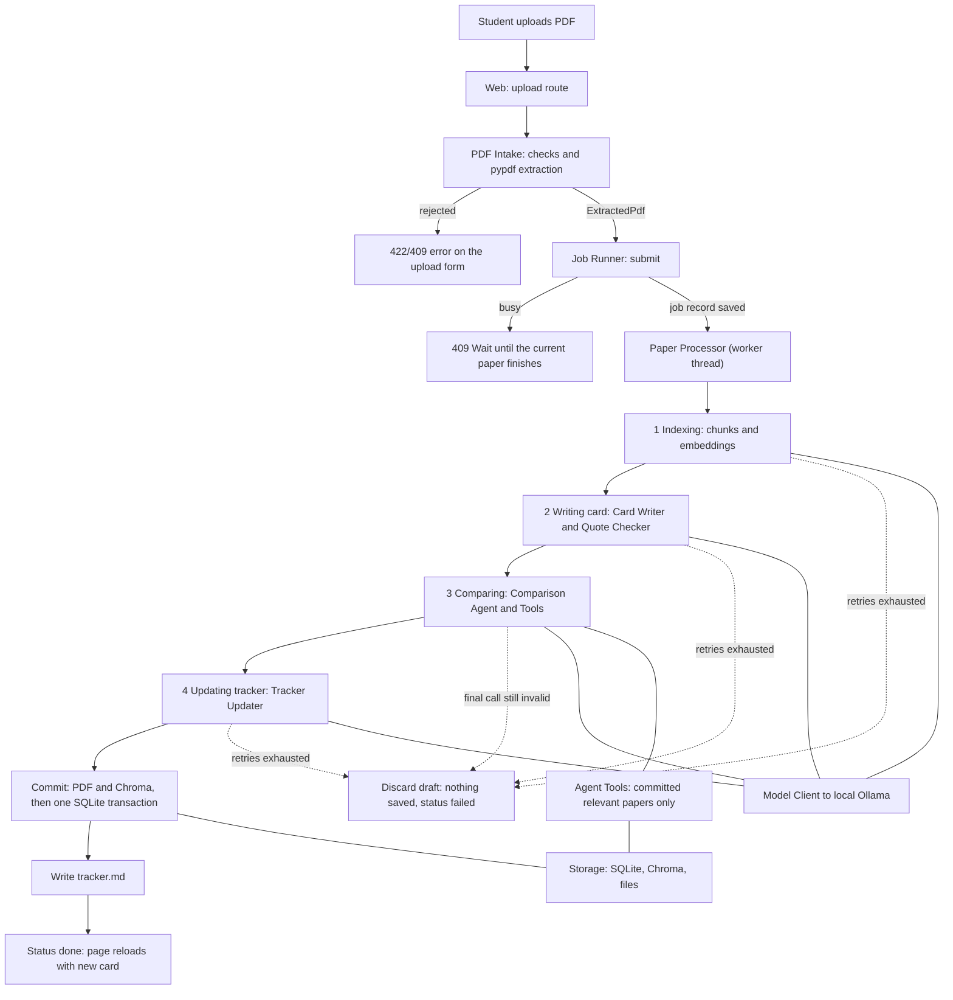

# Component Dependencies: Research Tracker

All communication is in-process Python function calls. The only network traffic is to local Ollama, through the Model Client (C-2). There are no message queues or other services.

## Dependency Matrix

Read across: the row component **uses** the column component. `models.py` and Settings are used by almost everything and are left out to keep the table readable.

| Uses → | Intake | Indexer | Model Client | Card Writer | Quote Checker | Agent | Tools | Tracker Updater | Coverage | Exporter | Storage | Processor | Job Runner |
|---|---|---|---|---|---|---|---|---|---|---|---|---|---|
| **Web** | ✓ | | | | | | | | ✓ | | ✓ | | ✓ |
| **Job Runner** | | | | | | | | | | | ✓ | ✓ | |
| **Processor** | | ✓ | ✓ | ✓ | | ✓ | | ✓ | | | ✓ | | |
| **Evaluation** | ✓ | | ✓ | | ✓ | | | | ✓ | ✓ | ✓ | ✓ | |
| **Agent** | | | ✓ | | | | ✓ | | | | ✓ | | |
| **Tools** | | ✓ | ✓ | | | | | | | | ✓ | | |
| **Tracker Updater** | | | ✓ | | | | | | | | ✓ | | |
| **Card Writer** | | | ✓ | | ✓ | | | | | | | | |
| **Quote Checker** | | | ✓ | | | | | | | | | | |
| **Indexer** | | | ✓ | | | | | | | | | | |
| **Intake** | | | | | | | | | | | ✓ | | |
| **Storage** | | | | | | | | | ✓ | ✓ | | | |
| **Coverage** | | | | | | | | | | | | | |
| **Exporter** | | | | | | | | | | | | | |
| **Model Client** | | | | | | | | | | | | | |

**No loops**. The components form layers, and each one uses only layers below it:

| Layer | Components |
|---|---|
| 5 | Web, Evaluation |
| 4 | Job Runner |
| 3 | Paper Processor |
| 2 | Comparison Agent |
| 1 | Agent Tools, Card Writer, Tracker Updater, PDF Intake |
| 0 | Indexer, Quote Checker, Storage |
| Base | Model Client, Coverage, Exporter, `models.py`, Settings |

Storage uses Coverage and the Exporter (both pure functions) to build the tracker view and `tracker.md`. They depend on nothing, so no loop forms.

**Coupling rules**:
- Only the Processor calls processing steps in sequence (Q1).
- Only the Model Client imports `openai`.
- Only Storage imports `sqlite3` and `chromadb`.
- The Agent and the Tools see Storage only through committed, relevant-only read methods.

## Data Flow: Uploading One Paper

### Mermaid Diagram



### Text Alternative

```text
Upload request (Web)
  -> PDF Intake: %PDF-, size, encryption, pages, text, 10-paper limit, duplicate
       rejected -> error shown immediately, nothing saved
  -> Job Runner.submit
       busy -> "Wait until the current paper finishes"
       else -> save job record, hand to worker thread, return 202

Worker thread (Paper Processor), all results kept in memory:
  1 Indexing          -> Indexer + Model Client (embeddings)
  2 Writing card      -> Card Writer + Quote Checker + Model Client
  3 Comparing         -> Comparison Agent + Agent Tools (committed, relevant papers only) + Model Client
  4 Updating tracker  -> Tracker Updater + Model Client
  any step fails after its retries -> discard draft, nothing saved, status "failed"

Commit (Storage): PDF file + Chroma entries, then ONE SQLite transaction (the commit point)
Write tracker.md from saved data
Status "done" -> page (polling) reloads and shows the new card and label
```

## Data Flow: Viewing and Inspecting

```text
GET /            -> TrackerStore.tracker_view -> Coverage.compute_coverage -> Jinja2 template (autoescape)
<details> click  -> no request; the passage is already in the page
PDF link         -> GET /papers/{id}/pdf#page=N -> TrackerStore.pdf_path(id) -> file (by ID only)
Export           -> GET /trackers/{id}/export -> current tracker.md
Polling          -> GET /api/trackers/{id}/status -> JobRunner.status
```

## Where Each Shared Constraint Is Enforced

| Constraint | Enforced in | How |
|---|---|---|
| C-1 Localhost only, telemetry off | `main.py`, README, Storage (`passages.py`) | Uvicorn host `127.0.0.1`; Chroma `anonymized_telemetry=False` |
| C-2 No outside requests | Settings, Model Client, Storage (`passages.py`) | Ollama URL must be localhost; only the Model Client makes network calls; Chroma collections use an embedding function that refuses to run and receive only precomputed vectors, so Chroma never downloads its default model. Optional: a test that blocks network access while the fake-model pipeline runs |
| C-3 Paper text never instructions | Comparison Agent (`prompts.py`), Card Writer, Tracker Updater, Agent Tools | Fixed system messages; paper text only in clearly marked content; tools are read-only |
| C-4 Autoescaping | Web templates | Jinja2 autoescape on; no `\|safe` on paper text or model output |
| C-5 SQL placeholders | Storage (`db.py`) | Only module that runs SQL; `?` placeholders only |
| C-6 Plain error messages | PDF Intake, Processor, Job Runner, Web, Settings, Storage | Errors carry a user-facing message; Web maps them to responses |
| C-7 Code, not model, for counts, quote checks and export | Coverage, Quote Checker, Exporter | Pure functions with no Model Client parameter |

## Pure Functions for Property-Based Tests (PBT Partial)

These have no model or storage dependency, so they are the targets of the blocking PBT rules (PBT-02, PBT-03, PBT-07, PBT-08, PBT-09; Hypothesis). Properties are identified in each unit's Functional Design.

| Function | Likely property types |
|---|---|
| `quotes.normalize`, `quotes.check_quote` | Invariants (for example, a span taken from a page and re-hyphenated across a line break is still found on that page); normalization is idempotent (advisory PBT-04) |
| `indexer.chunk_pages` | Invariants: chunks cover all page text in order, every page reference is a real page, sizes stay within limits |
| `coverage.compute_coverage` | Invariants: section counts sum to the number of relevant papers; total = relevant + not relevant; earliest ≤ latest |
| `export.render_markdown` | Invariants: footnote numbers are 1..n with no gaps; every unverified quote is marked |
| `models.py` serialization to and from SQLite rows or JSON | Round trips (PBT-02) |
