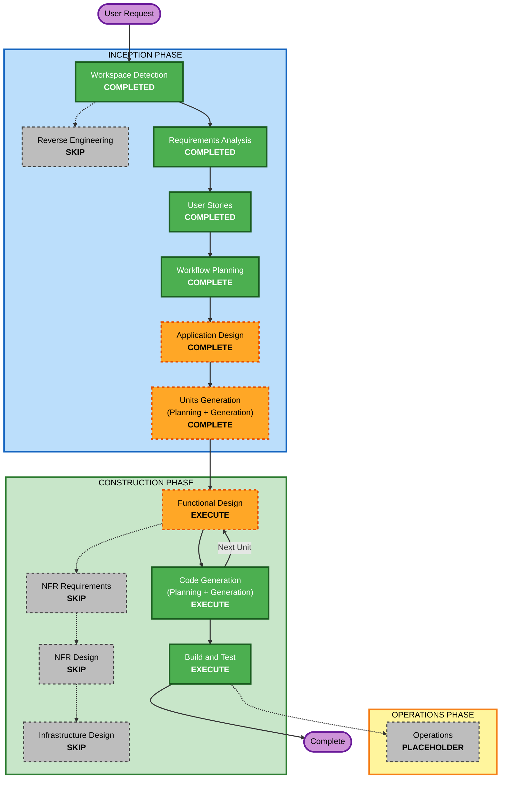

# Execution Plan: Research Tracker (MVP)

**Created**: 2026-11-24
**MVP deadline**: 2026-12-16 (about 3 weeks)
**Inputs**: `requirements.md`, `stories.md`, `personas.md`, `TechnicalDocument.md`

## Detailed Analysis Summary

### Transformation Scope

Not applicable. This is a greenfield project with no existing code.

### Change Impact Assessment

- **User-facing changes**: Yes. The whole product is new: a local web page (tracker, cards, labels, evidence, progress, export) and an evaluation command (US-01 to US-29).
- **Structural changes**: Yes. A new single-process FastAPI app with several internal parts: PDF intake, indexing, card writing, comparison agent and tools, tracker updates, counts, export, background processing, start-up cleanup, web views and evaluation.
- **Data model changes**: Yes. New SQLite schema (tracker, papers, cards, quotes, sections, labels, citations, processing records), a Chroma collection for passage embeddings, and files on disk (PDFs by hash, `tracker.md`, timing logs).
- **API changes**: Yes. New local endpoints: create tracker, upload paper, processing status, serve PDF by ID, export, dismiss notice. The model tools form an internal interface.
- **NFR impact**: Yes. Localhost-only access and safe handling of paper text (NFR-1), all-or-nothing saves across three stores (NFR-3), testing with a fake model and property-based tests (NFR-4), and unknown speed on laptops (NFR-2).

### Risk Assessment

- **Risk level**: Medium. Nothing is in production and git makes rollback easy, but several parts are uncertain:
  - **Model quality**: whether Qwen3 8B reaches 80% label agreement (SC-3) and gives valid structured output often enough
  - **Ollama behavior**: how context size and thinking mode are set (A-3, A-4), still to be confirmed
  - **Keeping three stores consistent**: SQLite, Chroma and files must save all-or-nothing (FR-11.2, FR-11.4)
  - **Schedule**: about 3 weeks, with approval gates that depend on team meetings every 2–4 days
- **Rollback complexity**: Easy (greenfield, version-controlled)
- **Testing complexity**: Complex. Model behavior can only be checked for structure in unit tests, and correctness needs the evaluation script and a manual quote checklist

## Workflow Visualization

### Mermaid Diagram



### Text Alternative

```text
INCEPTION PHASE
- Workspace Detection ........ COMPLETED
- Reverse Engineering ........ SKIPPED (greenfield)
- Requirements Analysis ...... COMPLETED
- User Stories ............... COMPLETED
- Workflow Planning .......... COMPLETE
- Application Design ......... COMPLETE
- Units Generation ........... COMPLETE

CONSTRUCTION PHASE (repeat for each unit)
- Functional Design .......... EXECUTE
- NFR Requirements ........... SKIP
- NFR Design ................. SKIP
- Infrastructure Design ...... SKIP
- Code Generation ............ EXECUTE (always)
After all units:
- Build and Test ............. EXECUTE (always)

OPERATIONS PHASE
- Operations ................. PLACEHOLDER
```

## Phases to Execute

### INCEPTION PHASE

- [x] Workspace Detection (COMPLETED)
- [x] Reverse Engineering (SKIPPED: greenfield, no existing code)
- [x] Requirements Analysis (COMPLETED)
- [x] User Stories (COMPLETED)
- [x] Workflow Planning (COMPLETE)
- [x] Application Design (**COMPLETE**)
  - **Rationale**: Every component is new. They need defined responsibilities, methods and dependencies:
    - PDF intake and validation
    - indexing
    - card pipeline and quote checking
    - comparison agent and its read-only tools
    - tracker updater
    - counts
    - Markdown export
    - storage across SQLite, Chroma and files
    - background processing and start-up cleanup
    - web views
    - evaluation
  - The README plans to "agree on shared data formats and tool interfaces before implementation." This stage is where that happens. It must also settle one cross-cutting design: how a paper is saved all-or-nothing across three stores.
- [x] Units Generation (**COMPLETE**)
  - **Rationale**: Four people will build five areas in parallel (README §4). The system needs splitting into units with clear boundaries, dependencies and a story-to-unit map, so that each owner can work against sample inputs and the fake model without waiting on others.

### CONSTRUCTION PHASE

- [ ] Functional Design: **EXECUTE** (per unit; light for units with little logic)
  - **Rationale**: Several units hold detailed business rules that code must enforce exactly:
    - label validity and citation rules (FR-6.5, FR-7.1, FR-7.4)
    - the first-paper path (FR-6.0)
    - quote normalization and minimum length (FR-5)
    - coverage counting (FR-9)
    - failure and cleanup rules (FR-11)
    - the data model
  - It is also where the open tuning values (A-2) get their defaults and where property-based test properties are identified (PBT-01, advisory in Partial mode).
- [ ] NFR Requirements: **SKIP**
  - **Rationale**:
    - The tech stack is already fixed by `TechnicalDocument.md`: Python 3.12, uv, FastAPI, Jinja2, `openai` with Ollama, `pypdf`, SQLite, Chroma, pytest, Hypothesis.
    - The NFRs are already specific: NFR-1 security, NFR-4 testing.
    - Performance deliberately has no target yet (NFR-2.1).
    - The Security and Resiliency extensions are off.
    - The remaining technical unknowns (thinking mode A-3, context size A-4) are short checks against Ollama. They are handled in the Functional Design of the unit that calls the model.
- [ ] NFR Design: **SKIP**
  - **Rationale**: Skipped because NFR Requirements is skipped. The patterns that matter are designed elsewhere:
    - all-or-nothing saves across stores, in Application Design
    - retries, in Functional Design
    - localhost binding and autoescaping, which are configuration
- [ ] Infrastructure Design: **SKIP**
  - **Rationale**:
    - The app runs only on each user's laptop, with no cloud resources, hosting or deployment pipeline.
    - Deployment is fully described in `TechnicalDocument.md` §2.
    - The Modelfile and `.env` settings are covered in FR-15.
- [ ] Code Generation: **EXECUTE** (always, per unit)
  - **Rationale**: Implementation planning and code generation for each unit, with unit tests that use the fake model.
- [ ] Build and Test: **EXECUTE** (always)
  - **Rationale**: Build instructions, unit and integration tests, and the evaluation run. This includes the manual quote checklist (SC-2), label agreement (SC-3), the SC-1 demo, and checks of the "Team practice" rows in the coverage table.

### OPERATIONS PHASE

- [ ] Operations: PLACEHOLDER
  - **Rationale**: Future deployment and monitoring workflows. Nothing is needed for a local MVP.

## Estimated Timeline

- **Stages still to run** (paused before Construction)
  - Functional Design and Code Generation per unit
  - Build and Test
- **Suggested schedule** toward 2026-12-16:

| Dates (2026) | Work |
|---|---|
| Nov 24 – Nov 27 | Application Design and Units Generation. Agree on shared data formats and the fake model before splitting up |
| Nov 28 – Dec 9 | Per-unit Functional Design and Code Generation, in parallel across owners, in dependency order |
| Dec 9 – Dec 13 | Integration, Build and Test, evaluation runs and tuning (thinking mode, chunk size) |
| Dec 14 – Dec 16 | Manual quote checklist, demo rehearsal (SC-1), fixes and buffer |

- **Note on approvals**: each stage waits for approval. To avoid waiting days between meetings, the team could agree that each unit's owner (with their reviewer) approves that unit's Functional Design and Code Generation plan, and bring only cross-unit decisions to meetings.

## Parallel Workstream: Labeled Test Set

This is not code, so no AI-DLC stage covers it. SC-2, SC-3 and SC-5 and stories US-24 to US-29 cannot be checked without it, so it runs alongside the stages above. It is a hard dependency of US-24.

- **Owner**: assigned by the team (one owner, plus a second labeler)

| By (2026) | Task |
|---|---|
| Nov 27 | Choose the research question and up to 10 papers. Check each paper's license. Fix the upload order |
| During Units Generation | Define the label file format (FR-17.5). Each paper records its upload position, expected label, the related section or paper, the relationship (agrees, contradicts, extends, unclear) and a short reason |
| Nov 30 (optional) | Turn two papers' expected cards and labels into fake-model test data, so units can use them from the start of Construction |
| Dec 3 | Two teammates label independently, then meet to reconcile disagreements |
| Dec 5 | Label file complete and frozen |
| Dec 9 | Used by the first full evaluation run |

**Rules**

- **Upload order is part of the labels.** Whether a paper is "New angle" or "Adds to," and which paper it is redundant with, depends on the papers uploaded before it. Each expected label means "the right label given the papers before it," and the evaluation uploads papers in that order.
- **Label before seeing the app's output.** Labels are written and reconciled before anyone runs the app on these papers, so they are not influenced by what the app says. Changes after freezing are recorded with a reason.
- **What the set must include** (one research question, up to 10 papers, all English text PDFs of 20 pages or fewer):
  - a redundant pair
  - a contradicting pair
  - an "extends" case
  - at least one off-topic paper, ideally uploaded first, to exercise FR-6.0
  - a paper with a missing year or missing authors
  - a multi-column layout
  - a PDF with many hyphenated line breaks, to stress quote checking
- **Licensing.** Use open-access papers whose licenses allow sharing, or keep the PDFs out of git (as `data/` and `eval-data/` already are). Decide this before committing any PDFs.

## Success Criteria

- **Primary goal**: A working local MVP that meets SC-1 to SC-5 on the team's labeled test set by 2026-12-16
- **Key deliverables**:
  - Application code at the repository root (`research_tracker` package), `pyproject.toml` and `uv.lock`
  - Modelfile, `.env` example and README setup instructions
  - Unit tests (fake model), model tests (marker-gated), property-based tests (PBT Partial) and quote hard-case tests
  - Evaluation script with report, quote checklist and stored-data check
  - Labeled test set: the papers (or instructions for getting them) and the frozen label file with upload order
  - AI-DLC design and build-and-test documents under `aidlc-docs/`
- **Quality gates**:
  - `uv run pytest` passes before every merge (NFR-4.1)
  - PBT-02, PBT-03, PBT-07, PBT-08 and PBT-09 are met for pure functions (Partial mode)
  - Every story's acceptance criteria and the shared constraints C-1 to C-7 are met
  - Evaluation shows SC-2 = 100% (manual checklist), SC-3 ≥ 80%, and SC-5 exact
  - The SC-1 demo runs end to end, including reopening the tracker
